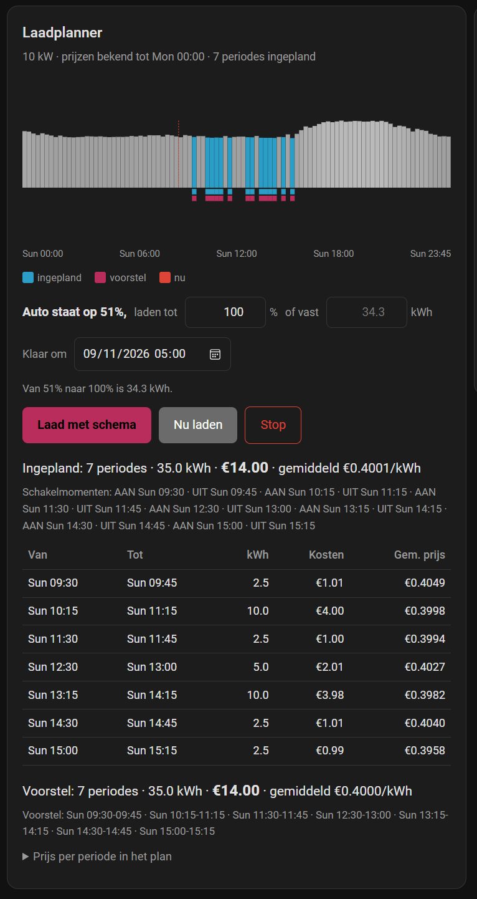

# Publiceren — handleiding voor Jille

Dit is jouw werkhandleiding, niet die van de gebruiker. Die staat in `README.md`.

Twee dingen om vooraf te weten. Het versienummer in `manifest.json` is wat HACS laat
zien én wat in de URL van de kaart staat; die twee hangen samen, en dat is precies waar
het deze keer misging. En de git-tag en dat versienummer moeten gelijk zijn, want HACS
haalt de code op bij de tag maar leest het nummer uit het bestand.

## Eenmalig: de repo online zetten

De repo staat nu lokaal in `C:\Users\jptre\Documents\claude\ev-charge-planner` met
`main` als branch en nog geen remote.

Met de GitHub CLI, in één keer, vanuit die map:

```bash
gh repo create jptreffers-creator/ev-charge-planner --public --source=. --remote=origin --push --description "Laad je auto in de goedkoopste kwartieren van de komende 48 uur"
```

Heb je `gh` niet, dan maak je de repo aan op github.com — publiek, naam
`ev-charge-planner`, en **geen** README, licentie of .gitignore laten aanmaken, want
die heb je al. Daarna:

```bash
git remote add origin https://github.com/jptreffers-creator/ev-charge-planner.git
git push -u origin main
```

De naam `jptreffers-creator/ev-charge-planner` zit al in `manifest.json` bij
`documentation` en `issue_tracker`, en in de installatie-instructies in de README. Wijk
je ervan af, pas die drie dan ook aan.

Zet daarna op de repo-pagina bij *About* een korte beschrijving en de topics
`home-assistant`, `hacs`, `ev-charging` en `dynamic-pricing`. Topics zijn een
HACS-vereiste als je ooit in de standaardlijst wilt, en kosten nu niets.

## Een release maken

HACS biedt alleen releases aan, geen losse commits. Het ritme is elke keer hetzelfde:

1. Hoog het `version`-veld in `custom_components/ev_charge_planner/manifest.json` op.
2. Commit dat mee met je wijziging.
3. Tag en push.
4. Maak er een release van.

```bash
git tag -a v0.2.0 -m "v0.2.0"
git push origin main --tags
gh release create v0.2.0 --title "v0.2.0" --notes "Eerste publieke versie."
```

Zonder `gh`: op github.com → *Releases* → *Draft a new release*, kies de tag die je net
pushte, en publiceer.

**Hoog het versienummer op bij élke wijziging aan de kaart.** De integratie serveert de
kaart op `/ev_charge_planner/ev-charge-planner-card.js?v=<versie>`. Blijft die versie
gelijk, dan blijft de browser zijn oude kopie gebruiken, en zie je je wijziging niet —
dat heeft ons hier een halve avond en zes bestandsnamen gekost. Verandert het nummer,
dan verandert de URL en laadt de browser de kaart vanzelf opnieuw.

Versienummers: `0.2.1` voor een reparatie, `0.3.0` voor iets nieuws, `1.0.0` als je
vindt dat hij af is. Verbreek je een bestaande installatie — een instelling die
verdwijnt, een entiteit die anders gaat heten — hoog dan het middelste cijfer op en zeg
het in de release-notities.

## Hoe iemand het installeert

Handig om te weten als je het iemand uitlegt, en het staat zo ook in de README. In HACS
onder het drie-puntjes-menu kiest men *Custom repositories*, vult daar
`https://github.com/jptreffers-creator/ev-charge-planner` in met categorie
*Integration*, installeert *EV Charge Planner*, herstart Home Assistant en voegt de
integratie toe onder *Instellingen → Apparaten en diensten*.

De kaart hoeft niemand te registreren. De integratie dient hem zelf uit en meldt hem
aan bij de frontend.

## Testen voordat je publiceert

In de repo staat `.github/workflows/validate.yml`. Die draait bij elke push twee
controles: *hassfest*, de officiële controle van Home Assistant op je `manifest.json`
en de structuur van de integratie, en de HACS-validatie op wat HACS van een repo
verwacht. Zien die groen, dan weet je dat de verpakking klopt.

De logica test je lokaal:

```bash
python -m unittest discover -s tests
```

Die tests importeren Home Assistant niet, dus ze draaien op elke Python. Ze dekken de
planlogica, de prijsadapters en de verversrem van de auto — niet de HA-lijm eromheen.
Dat deel test je door het bij jezelf te installeren.

## Als je ooit in de HACS-standaardlijst wilt

Dan hoeft niemand je repo meer als custom repository toe te voegen. Het is geen haast
en geen voorwaarde; de integratie werkt zonder. Wat ze vragen:

- De repo is publiek, heeft een beschrijving en topics, en een README die uitlegt wat
  het doet en wat je nodig hebt.
- `manifest.json` heeft `documentation`, `issue_tracker`, `codeowners`, `version` en
  `config_flow`. Dat is nu alles al het geval.
- Er is minstens één release.
- Er is een pictogram. Dit is het enige onderdeel waar je echt iets nieuws voor moet
  maken, en de manier waarop is sinds Home Assistant 2026.3 veranderd: een custom
  integratie levert zijn eigen afbeeldingen mee, in een map `brand/` binnen de
  integratie zelf. Voor ons dus `custom_components/ev_charge_planner/brand/`. Een
  pull request op `home-assistant/brands` is niet meer nodig; de oude map
  `custom_integrations/` daar wordt in hun eigen README legacy genoemd.
  - `icon.png`, vierkant, 256×256, en `icon@2x.png` van 512×512.
  - `logo.png` mag, liefst liggend, kortste zijde 128–256 px (en `logo@2x.png`
    256–512 px). Laat je hem weg, dan wordt het pictogram gebruikt.
  - PNG, graag met transparantie, en bijgesneden zodat er geen lege rand om zit.
  - `dark_icon.png` en `dark_logo.png` alleen als het donkere thema het nodig heeft.
  - Gebruik geen afbeeldingen met Home Assistant-huisstijl: dat wekt de indruk dat
    het een officiële integratie is. En niet het logo van een ander bedrijf.
  - De Marketplace haalt die afbeeldingen elk uur op bij de *laatste release*, dus
    ze moeten in een release zitten voordat ze ergens opduiken. Reken daarnaast op
    cachevertraging: browsers 7 dagen, Cloudflare 24 uur.
- hassfest en de HACS-actie zijn groen. De workflow slaat nu de `brands`-controle
  over met `ignore: brands` in `.github/workflows/validate.yml`. Zodra je die
  `brand/`-map hebt, haal die regel er weer uit en kijk of de controle slaagt.

Daarna een pull request op `hacs/default` waarin je de repo aan het bestand
`integration` toevoegt. Reken op wachttijd; het is een wachtrij met vrijwilligers.

## Nog niet gedaan

De README heeft nu geen schermafbeelding, maar een afbeelding van de kaart boven
aan de README helpt mensen enorm bij de keuze om het te installeren. Als je er ooit een
maakt: `docs/card.png`, en dan deze regel onder de inleiding:

```markdown

```

De adapters voor Nord Pool en EnergyZero zijn op hun gedocumenteerde vorm gebouwd en
nooit tegen een echte installatie getest. Dat staat eerlijk in de README. De eerste
gebruiker met zo'n bron is je test; vraag hem om de attributen uit *Ontwikkelhulpmiddelen
→ Statussen* als het niet werkt.
