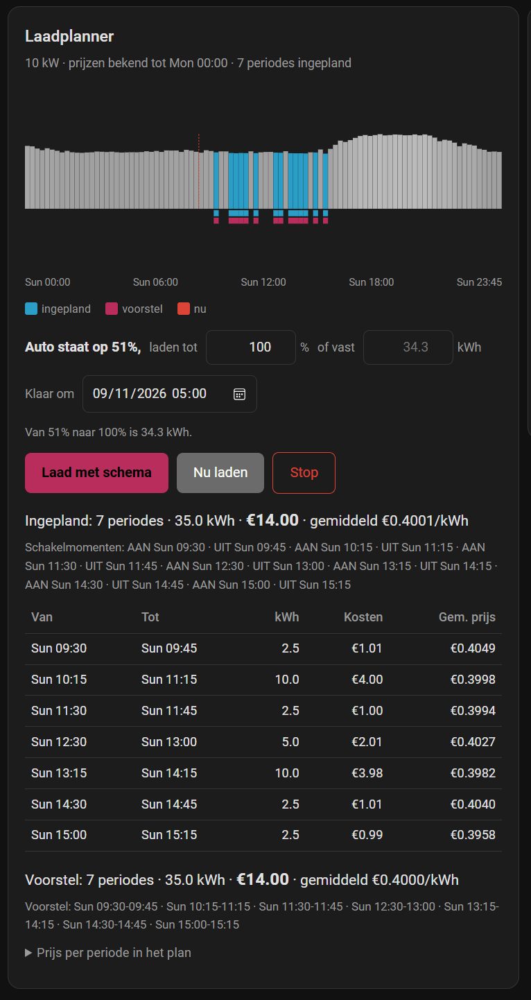

# EV Charge Planner


Charge your car in the cheapest settlement periods of the next 48 hours.

You say how much energy you want and by when. The planner reads your dynamic
electricity prices, picks the cheapest periods before your deadline, and switches your
charger on and off at those moments. The periods do not have to be contiguous — it
will happily charge from 02:45 to 03:00, pause through an expensive quarter, and pick
up again at 03:30, because that is where the money is.



That is a real day: seven separate periods between 09:30 and 15:15, skipping the
expensive quarters in between, 35 kWh for EUR 14.00 at an average of EUR 0.4001/kWh.

## What you need

Two things, and only the first is required.

**A price entity that publishes future prices.** Not just the current price — the
planner needs the upcoming periods in an attribute. In practice that means one of the
integrations below, or anything else that works the same way.

**An entity that turns charging on and off.** Usually a `switch` from your charger's
integration. The planner never talks to your charger directly: it flips that entity,
and your charger's own integration does the rest. That is why it works with a Peblar,
an Easee, a Wallbox, a go-e, a smart plug, or a relay behind a contactor — anything
that appears in Home Assistant as something switchable.

Optionally, a power sensor and a session-energy sensor from the charger. They are used
only to measure your real charging speed, which you can then adopt with one button.

And optionally a car integration, so the planner can work out how much energy is still
needed from the actual charge level instead of you typing a number.

## Price sources

| Source | Status |
|---|---|
| ENTSO-e | Verified against a live instance |
| Nord Pool | Written from its documented attribute shape, untested |
| EnergyZero | Written from its documented attribute shape, untested |
| Anything else | Use **Other** and name the attribute and keys yourself |

If your source is not listed, pick **Other**. You will be asked for the name of the
attribute holding the price list, and the keys inside each entry. Look them up under
*Developer tools → States*, select your price sensor, and read its attributes. If you
get it working for a source not listed here, an issue with the three names is enough
for it to become a preset.

## Installing

### Through HACS

1. HACS → three-dot menu → **Custom repositories**
2. Add `https://github.com/jptreffers-creator/ev-charge-planner`, category **Integration**
3. Install **EV Charge Planner**, then restart Home Assistant
4. Settings → Devices & services → **Add integration** → *EV Charge Planner*

### By hand

Copy `custom_components/ev_charge_planner` into your `config/custom_components/`
directory and restart Home Assistant.

The card comes with the integration and registers itself. There is nothing to add
under Dashboards → Resources.

## Setting it up

Four steps, all with entity pickers:

1. **Electricity prices** — your price integration and the sensor carrying the
   upcoming prices. For most sources that is the "average price" sensor rather than
   the "current price" one, because that is where the whole day lives.
2. **Charger** — the switch that starts and stops charging. The two sensors are
   optional.
3. **Car** — optional. Choose *No car linked* and you simply enter kWh yourself.
4. **Defaults** — charging power, battery capacity, target level, and the time you
   normally want the car ready.

All of it can be changed afterwards under the integration's **Configure** button.

## Using it

Add the card to any dashboard:

```yaml
type: custom:ev-charge-planner-card
```

No options needed; it finds its own entities. If you run more than one planner, give
each card a `prefix:` matching its entity names.

Then: set how full you want the car, or a fixed number of kWh, set when it should be
ready, and press **Schema laden**. The planner books the cheapest periods and charges
there. **Stop** clears the schedule and switches off.

**With no schedule, the planner does not touch your charger at all.** That is
deliberate — it means you can always charge by hand without the planner fighting you
for the switch.

### Charging now, whatever the price

**Laad nu** ignores the schedule and the prices and switches the charger on straight
away. Use it when you need the car charged more than you need it charged cheaply.

It stays on until you turn it off. It does not expire by itself, and that is a choice
rather than an omission: the obvious expiry would be "stop at the target charge level",
but the car is polled rarely by design, so during a session that figure barely moves
and the override would outlive its own promise. One rule that holds beats a clever one
that does not. While it is on, the card says so.

Turning it off is not the same as stopping. Off hands the decision back to the
schedule, which may well want to carry on charging; **Stop** clears the schedule and
switches off.

It is also a switch, `switch.*_charge_immediately`, so an automation or a voice command
can flip it.

## About polling your car

Several car integrations wake the vehicle to answer, which drains its 12V battery.
Owners often set a slow poll interval on purpose, and an integration that quietly
polls more often undoes that choice.

So this one never polls on a timer. A refresh is requested **only when the planner
card is opened**, and even then only if the reading is older than the threshold you
set, and never twice within fifteen minutes. All of those conditions are enforced in
the integration, not in the card, so reloading your dashboard twenty times still wakes
the car at most once.

If you would rather it never asked at all, leave the refresh button empty during
setup.

## Calibrating the charging speed

The planner reserves periods based on the charging power you configured. If that
number is wrong, so is every cost estimate.

While charging, the integration measures what your charger actually delivers and
averages it over recent sessions, publishing it as *Measured charging power*. Press
**Use measured charging power** to adopt it. On a nominal 11 kW charger, 9.9 kW is a
perfectly normal real-world figure.

## What it does not do

- **On and off only.** It does not modulate current, so no "charge at 10 A instead
  of 16". If your charger exposes only a current limit and no on/off entity, this
  integration cannot drive it.
- **No load balancing** against the rest of the house.
- **No solar surplus following.**
- **No control of a home battery.** If you want your house battery to stop discharging
  while the car charges, write a small automation that reacts to the same charging
  switch. That keeps the two concerns apart and works regardless of which battery you
  have.

## Entities

| Entity | What it is |
|---|---|
| `sensor.*_plan_periods` | The scheduled periods, as readable text |
| `sensor.*_plan_cost` / `_plan_energy` | What the schedule costs and delivers |
| `sensor.*_suggested_periods` / `_suggested_cost` | What pressing Start would book |
| `sensor.*_energy_needed` | kWh still to add |
| `sensor.*_car_charge_level` | The car's level, with its age as an attribute |
| `sensor.*_measured_charging_power` | Measured over recent sessions |
| `sensor.*_prices_known_until` | End of the priced horizon |
| `binary_sensor.*_charge_now` | Whether now falls inside a scheduled period |
| `binary_sensor.*_plan_fully_priced` | Off when the plan runs past the priced horizon |
| `switch.*_charge_immediately` | Charge now, ignoring schedule and prices |
| `number.*` | Charging power, battery capacity, target level, fixed kWh |
| `datetime.*_ready_by` | The deadline |
| `button.*` | Start charging, Stop, adopt measured power, refresh car |

Services mirror the buttons: `ev_charge_planner.apply_suggestion`, `.stop`,
`.refresh_car` and `.adopt_measured_power`. With more than one planner configured,
pass `entry_id`.

## Troubleshooting

**No proposal.** Check that something is actually needed — if the car is already above
the target, there is nothing to plan. Check the deadline is in the future. Check
*Prices known until*: tomorrow's prices usually appear in the early afternoon, so a
deadline past that horizon has fewer periods to choose from.

**The card says "Custom element doesn't exist".** Reload with Ctrl+Shift+R. The card
is served by the integration with its version in the URL, so an upgrade normally
retires the cached copy by itself.

**Prices unavailable.** The planner keeps its last good plan rather than blanking, but
it cannot price anything new. Look at your price integration first.

## Licence

MIT. See [LICENSE](LICENSE).
